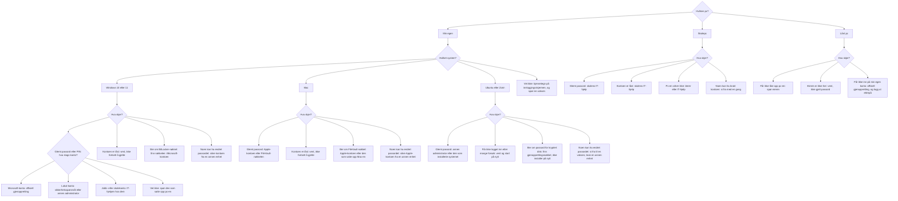

# Tilgangsstien: plan

Klikkbar veiviser for noen som ikke kommer inn på pc-en sin. Hvert valg lyser opp neste stopp på en sti, og stien ender i trygge råd.

Status: under bygging. Ubuntu/Zorin-veien er ferdig. Windows, Mac, "vet ikke", skolepc, lånt pc og PWA gjenstår, og de valgene vises som "Kommer snart".

Kjør lokalt med `npm run dev` og åpne http://localhost:3001. Siden oppdaterer seg selv når filer i `frontend/` endres.

## Rammer

- **Bare valgknapper.** Ingen tekstfelt, skjema, innlogging eller søk.
- **Ingen personopplysninger.** Appen spør aldri om navn, passord, e-post, skole eller lignende.
- **Ingenting lagres.** Valgene ligger bare i minnet og forsvinner når siden lukkes. Ingen cookies, `localStorage`, analyse eller logging av besøk. Dette er ekstra viktig på lånte og delte pc-er.
- **Nullstilling bare på egen pc.** Egen-pc-veien kan vise konkrete kommandoer for å nullstille passordet, blant annet via GRUB og recovery mode. Fordi metoden virker på hvilken som helst maskin, vises slike kommandoer aldri på skolepc eller lånt pc, og rådet har alltid en eierskapsadvarsel. Testene håndhever grensen. Skolepc og lånt pc peker til skolens IT eller eier.
- **Mobil først.** Den som er låst ute av pc-en bruker trolig telefonen, så appen må virke godt på telefon og uten nett.
- **Enkelt språk.** Bokmål, korte setninger, tilpasset unge brukere.
- **Støttede systemer.** Windows 10 og 11, Ubuntu og Zorin OS, og macOS. Det gjelder både rådene og selve appen.
- **Systemet velges med knapp.** Appen leser ikke `userAgent`, fordi enheten brukeren sitter på ofte ikke er pc-en de er låst ute av.

## Struktur

Samme stil som `kodeklubb/eksempel`: Node uten eksterne pakker, ren HTML, CSS og JS, og tester med `node --test`.

```text
tilgangsstien/
├── package.json             npm start, npm test
├── README.md
├── .gitignore
├── frontend/
│   ├── index.html
│   ├── style.css
│   ├── veiviser-data.js     spørsmål, valg og råd (bare innhold)
│   ├── veiviser.js          ren logikk: neste steg, tilbake, sti-stopp
│   ├── app.js               tegner siden og stien, styrer fokus
│   ├── sw.js                service worker, offline
│   ├── manifest.webmanifest
│   └── icons/               192, 512 og maskable
├── backend/
│   ├── server.mjs           serverer frontend med sikkerhetshoder
│   └── server.test.mjs
└── docs/
    ├── PLAN.md
    └── KILDER.md            offisielle lenker, med dato de sist ble sjekket
```

Tester av innhold og logikk legges som `frontend/veiviser.test.mjs`, og filen serveres ikke.

### Backend er bevisst tynn

Appen trenger verken API eller database. Backend gjør bare dette:

- Serverer en fast liste med filer, som i `eksempel`.
- Setter sikkerhetshoder, blant annet `Content-Security-Policy` med `default-src 'self'`, `connect-src 'self'`, `form-action 'none'` og `frame-ancestors 'none'`.
- Setter riktig cache for `sw.js`, slik at oppdateringer når frem.
- Logger ikke forespørsler.

All logikk ligger i frontend, så appen virker offline. Den kan også legges på en statisk vert senere, men da må hodene settes der.

## Beslutningstre



Skolepc og lånt pc spør ikke om system, fordi rådet er det samme: IT-hjelpen eller eieren tar seg av pc-en. Der brukeren skal inn på sin egen nettkonto fra en lånt pc, velger de Microsoft, Apple eller Google.

Forskjeller mellom systemene:

- **Windows 10 og 11** deler knapp. Der skjermbildene er ulike, sier rådet det.
- **Ubuntu og Zorin** deler knapp, fordi Zorin bygger på Ubuntu. Der finnes det ingen nettkonto å gjenopprette, så rådene peker til en annen administrator eller den som installerte systemet.
- **Oppstart i recovery mode vises** på egen-pc-veien, med ekte kommandoer. Siden metoden virker på andres pc også, er den avgrenset til egen pc og har en eierskapsadvarsel.
- **Kryptert disk på Linux:** uten passord eller gjenopprettingsnøkkel kan dataene ikke hentes tilbake. Rådet sier tydelig at brukeren skal be om hjelp før noe installeres på nytt.

Hvert råd har samme oppbygning:

1. **Gjør dette:** 2 til 4 konkrete steg.
2. **Hvem kan hjelpe:** for eksempel en voksen, skolens IT-hjelp eller leverandørens støtte.
3. **Offisiell lenke:** når rådet har en. Adressen vises også som tekst, slik at den kan skrives inn på en annen enhet.
4. **Trygghetsregler:**
   - Ikke del passord eller engangskoder med noen.
   - Ikke bruk nettsider eller programmer som lover å knekke eller fjerne passord.
   - Skriv adressen selv i stedet for å følge lenker fra meldinger.
   - Vær skeptisk til noen som tar kontakt og tilbyr "support".

### Offisielle lenker

Disse er utgangspunktet. Hver lenke sjekkes mot leverandørens egne sider under bygging og føres i `docs/KILDER.md`.

| Råd | Adresse |
| --- | --- |
| Microsoft-konto | `account.live.com/password/reset` |
| BitLocker-nøkkel | `aka.ms/myrecoverykey` |
| Apple-konto | `iforgot.apple.com` |
| Google-konto | `accounts.google.com/signin/recovery` |
| Windows, lokal konto | Microsofts støtteside, adresse finnes under bygging |
| Mac, glemt passord og FileVault | Apples støttesider, adresser finnes under bygging |
| Ubuntu | Offisiell hjelp på `help.ubuntu.com` |
| Zorin OS | Offisiell hjelp på `help.zorin.com` |

## Stien

- Tegnes som inline SVG: en buktende linje med stopp. Den ligger vannrett på alle skjermer, slik at spørsmålet og knappene også synes uten scrolling på mobil.
- Stoppene er **Pc**, **System** (bare egen pc), **Problem**, **Konto** (bare der den trengs) og **Råd**.
- Når brukeren velger, tennes linjen frem til neste stopp, og stoppet lyser opp. Stopp som er passert viser valget som ble tatt.
- Stien gir aldri informasjon bare med farge. Stopp har også form og tekst, som "Du er her".
- Knappene **Tilbake** og **Start på nytt** finnes på alle steg etter det første.

## Tilgjengelighet

- Ekte `<button>`-elementer, full tastaturstyring og synlig fokus.
- Fokus flyttes til ny overskrift ved hvert steg, og endringen leses opp med `aria-live`.
- Stien har en tekstversjon for skjermleser, for eksempel "Steg 2 av 4".
- `prefers-reduced-motion` skrur av animasjon. Mørk modus følger systemet.
- Kontrast minst WCAG AA, og trykkflater minst 44 px.

## PWA

- `manifest.webmanifest` med navn, ikoner, `display: standalone` og `lang: nb`.
- `sw.js` lagrer alle filer ved installasjon og svarer fra cache først. Versjonert cache, og gamle versjoner slettes ved aktivering.
- Hele veiviseren virker offline. Eksterne lenker krever nett, og da kan brukeren lese adressen fra skjermen.
- Installering krever HTTPS i drift. `localhost` holder under utvikling.

### Nettlesere og systemer

Appen må virke i nettleseren uten å være installert, for ikke alle nettlesere tilbyr installering. Firefox er standard på Ubuntu og Zorin, og der er vanlig bruk med offline-støtte hovedveien.

| System | Nettlesere som testes | Installering |
| --- | --- | --- |
| Windows 10 og 11 | Edge, Chrome, Firefox | Edge og Chrome |
| Ubuntu og Zorin | Firefox, Chrome | Chrome |
| macOS | Safari, Chrome | Safari (Legg til i Dock) og Chrome |

Vi bruker ingen funksjoner som bare finnes i én nettleser. Mobil (Android og iPhone) testes også, siden det er den vanligste enheten for en som er låst ute. Installasjonsstøtten i tabellen sjekkes mot gjeldende dokumentasjon under bygging.

## Byggerekkefølge

1. **Grunnmur:** `package.json`, `.gitignore`, server med hoder, tom side.
2. **Innhold og logikk (test først):** `veiviser-data.js` og `veiviser.js`, og sjekk av offisielle lenker.
3. **Grensesnitt:** valgknapper, råd og navigasjon, med fokusstyring.
4. **Stien:** SVG, opplysing og tekstversjon. Visuell retning settes og sjekkes på mobil og desktop.
5. **PWA:** manifest, ikoner, service worker og offline-test.
6. **Avslutning:** README, gjennomgang i nettleser og Lighthouse.

## Slik sjekker vi at det virker

Automatiske tester med `npm test`:

- Alle valg fører til et steg som finnes. Ingen blindveier eller løkker.
- Alle steg kan nås, og alle stier ender i et råd.
- Alle tre pc-typene finnes. Skolepc-råd nevner IT-hjelp, og alle eksterne lenker er HTTPS og står på en godkjentliste.
- Egen pc tilbyr Windows, Mac, Ubuntu/Zorin og "vet ikke", og hvert system har råd for glemt passord, låst konto, diskkryptering og mistanke om at noen andre har vært inne.
- Råd for ett system lenker ikke til et annet systems sider.
- Frontend-filene bruker ikke `userAgent` eller `navigator.platform`.
- Frontend-filene inneholder ikke `<input>`, `<textarea>`, `<form>`, `localStorage`, `sessionStorage`, `cookie`, `indexedDB` eller `fetch` til eksterne adresser.
- Serveren gir 404 for filer utenfor listen, og setter sikkerhetshodene.

Manuelt i nettleser:

- Gå gjennom alle stier, med mus og med bare tastatur.
- Slå av nettet og last inn på nytt. Veiviseren skal fortsatt virke.
- Sjekk i nettverksfanen at ingen forespørsler går til eksterne adresser.
- Sjekk på smal mobilskjerm at det ikke blir vannrett scrolling.
- Lighthouse: PWA kan installeres, og tilgjengelighet er uten alvorlige funn.
- Kjør gjennom tabellen under "Nettlesere og systemer". Utvikling skjer på Windows, så Ubuntu, Zorin og macOS må testes på ekte maskiner eller i virtuell maskin.
- Noen som kjenner systemet leser gjennom rådene for Ubuntu, Zorin og macOS, siden de ikke kan prøves fullt ut herfra.

## Utenfor denne versjonen

Innlogging, statistikk, flere språk, skolespesifikke kontaktdata, AI-chat, og egne råd for Chromebook og andre Linux-varianter (de havner under "vet ikke"). Fritekst ville også bryte kravet om bare valgknapper.

## Åpne spørsmål

1. **Backend:** er tynn statisk server greit? Anbefaling: ja, fordi API eller database bare ville gitt mer å beskytte, uten nytte for brukeren.
2. **Målgruppe:** elever på rundt 10 til 16 år? Det styrer språket og hvor ofte rådene nevner en voksen.
3. **Publisering:** skal appen på nett nå, og i så fall hvor? Det må være HTTPS for at den skal kunne installeres.
